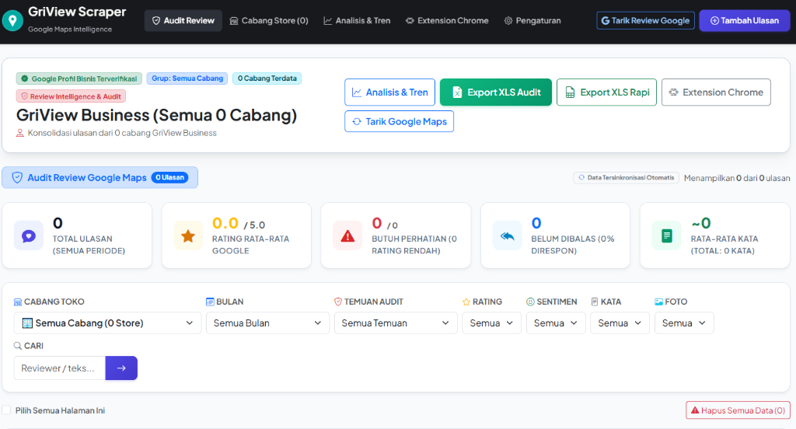

<!-- License: by cs.baguosps@gmail.com -->
# 📍 GriView - Google Maps Review Audit & Analytics Platform

[](https://www.php.net/)
[](mailto:cs.baguosps@gmail.com)
[](chrome-extension/)
[](app/)

<p align="center">
  
</p>

**GriView** is an intuitive, all-in-one Google Maps review audit and reputation analytics platform paired with an official **Google Chrome Extension (Manifest V3)**.

Designed for business owners, agency consultants, and reputation managers, GriView makes it effortless to scrape, filter, analyze, and export Google Maps customer reviews into beautifully formatted, executive-ready **Microsoft Excel (.XLS)** spreadsheets.

---

## 🌟 Key Features

### 1. 🔍 Client-Side Google Maps Review Scraper
- **Safe & Browser-Based**: Runs directly inside your browser. Because scraping happens through your active Google session, there is **zero risk of IP bans** and **no paid Google API keys required**.
- **Smooth Auto-Scrolling**: Effortlessly collects up to **1,000 reviews** per business with customizable limits (50, 100, 200, 500, or 1,000 reviews).
- **Flexible Floating Stop Button**: Stop the extraction process at any time and immediately view or export the reviews collected so far.
- **Accurate Photo & Content Detection**: Automatically detects review photos (including multi-photo galleries and overflow badges), reviewer lifetime contribution badges, word count, and flags brief/spam-like reviews.

### 2. 🛡️ 100% Standalone Chrome Extension Mode
- **No Web Server Required**: The extension can operate completely standalone. Users can audit Google Maps places and export Excel (.XLS) spreadsheets entirely inside their browser.
- **Interactive Toolbar Popup**: Click the GriView extension icon in your toolbar to paste a Google Maps link, select your review limit, and start auditing in one click.
- **Auto-Sync to Web Dashboard**: When connected to the GriView web platform, all scraped reviews are automatically saved and organized into your central database.

### 3. 📊 Executive Excel (.XLS) Export
- **One-Click Export**: Generates professional, clean **XML Spreadsheet (.XLS)** files compatible with **Microsoft Excel**, **Google Sheets**, and **WPS Office**.
- **Formatted Header & KPI Summary**: Includes business name, branch address, review totals, average star rating, and customer sentiment distribution.
- **Visual Styling**: Dark navy table headers, auto wrap-text for long review comments, visual star ratings (`★★★★★`), and color-coded sentiment tags.

### 4. 📈 Interactive Analytics Dashboard (Chart.js)
- **Review Volume & Rating Trends**: Track how your customer satisfaction and review volume evolve over months.
- **Sentiment Breakdown**: Automatic categorization into Positive (4-5 stars), Neutral (3 stars), and Critical/Negative (1-2 stars).
- **Rating Distribution**: Clear breakdown of 1-star through 5-star ratings.
- **Owner Response Rate**: Monitor how many reviews have been answered versus how many are still pending a response.

### 5. ⚙️ Zero-Config Database & Easy Branding
- **Zero-Setup Database**: Uses a lightweight flat-file JSON storage (`app/data/`). No MySQL setup, database users, or SQL migrations needed.
- **Custom Branding**: Easily upload your company logo, favicon, and social preview banners from the settings page with built-in image compression (PNG Level 9 GD).

---

## 🏛️ Project Directory Structure

```text
griview/
├── index.php                          # Front Controller & MVC Router
├── .htaccess                          # Apache security rules & MIME configuration
├── README.md                          # Documentation (English)
├── app/
│   ├── config/
│   │   └── config.php                 # App configuration & automatic BASE_URL detection
│   ├── controllers/
│   │   ├── ReviewController.php       # Review management, filters, and XLS export
│   │   ├── StoreController.php        # Store locations & business profiles
│   │   ├── AnalyticsController.php    # Visual analytics and Chart.js metrics
│   │   ├── ExtensionController.php    # Chrome extension sync bridge & ZIP downloads
│   │   └── SettingsController.php     # Branding center & image compression
│   ├── models/
│   │   ├── Review.php                 # Review data model and word counter
│   │   ├── Store.php                  # Store data model
│   │   └── PlaceConfig.php            # App settings and branding data
│   ├── helpers/
│   │   ├── JsonDatabase.php           # Safe flat-file JSON database handler
│   │   └── ExcelHelper.php            # Executive XML Excel (.XLS) spreadsheet generator
│   ├── views/
│   │   ├── layouts/                   # Header, navbar, and footer layouts
│   │   ├── reviews/                   # Audit tables, search, and filtering views
│   │   ├── store/                     # Store location management
│   │   ├── analytics/                 # Charts and performance dashboard
│   │   ├── extension/                 # Extension download and installation guide
│   │   └── settings/                  # Branding and system preferences
│   └── data/                          # Auto-created JSON data storage
│       ├── reviews.json               # Saved review records
│       ├── stores.json                # Saved business locations
│       ├── settings.json              # App settings and branding config
│       └── jobs.json                  # Background audit job logs
├── assets/
│   ├── css/style.css                  # Modern UI styles
│   ├── uploads/                       # Custom logos, favicons, and banners
│   └── griview-chrome-extension.zip   # Packaged Chrome extension installer
└── chrome-extension/
    ├── manifest.json                  # Manifest V3 extension configuration
    ├── icons/                         # Extension icons (16px, 48px, 128px)
    ├── background.js                  # Background service worker
    ├── maps-audit.js                  # Google Maps review scraper engine
    ├── griview-bridge.js              # Communication bridge between web app and extension
    ├── popup.html / popup.js          # Toolbar popup interface
    ├── audit.html / audit.js          # Standalone review audit results and export page
    └── search.js                      # Injector for Google Search Knowledge Panels
```

---

## 🧭 Chrome Extension Installation

You can install and use the Chrome extension in less than a minute:

1. **Download or Locate the Extension**:
   - Use the `chrome-extension/` directory included in this repository, or download `assets/griview-chrome-extension.zip` and extract it.
2. **Open Extensions in Chrome**:
   - In Google Chrome, navigate to `chrome://extensions/`.
3. **Enable Developer Mode**:
   - Toggle the **Developer mode** switch in the top-right corner.
4. **Load the Extension**:
   - Click **Load unpacked** (top-left) and select the `chrome-extension/` folder.
5. **Pin & Start Auditing**:
   - Pin **GriView** to your browser toolbar.
   - Open any Google Maps location, click the GriView icon, choose your review target limit, and click **Mulai Audit (Start Audit)**!

> 💡 **Tip:** Whenever you update the extension code, simply click the **Reload (🔄)** icon on the GriView card inside `chrome://extensions`.

---

## 🚀 Running the Web Platform Locally (XAMPP / PHP)

If you want the full web dashboard with persistent database storage and analytics:

### Method 1: Using XAMPP (Windows)
1. Copy or clone this folder into:
   ```text
   C:\xampp\htdocs\griview
   ```
2. Open **XAMPP Control Panel** and click **Start** next to **Apache** *(MySQL is not required)*.
3. Open your browser and visit:
   ```text
   http://localhost/griview/
   ```

### Method 2: Using the Built-in PHP Server
1. Open your terminal or PowerShell:
   ```powershell
   cd C:\xampp\htdocs\griview
   php -S localhost:8080
   ```
2. Open `http://localhost:8080` in your browser.

---

## 🌐 Deploying to Web Hosting (cPanel / DirectAdmin / VPS)

GriView is designed to be **Zero Configuration (Plug and Play)**:

1. **No MySQL Database Setup**: Everything is saved to lightweight JSON files in `app/data/`. You do not need to configure database credentials.
2. **Automatic Base URL Detection**: The app automatically identifies whether it is running on `http`, `https`, a domain, a subdomain, or a subfolder.
3. **Deployment Steps**:
   - Compress the project files (`app`, `assets`, `chrome-extension`, `index.php`, `.htaccess`) into a `.zip` file.
   - Upload and extract the archive into your web root (e.g., `public_html` or a subdomain folder).
   - Ensure the following directories have write permissions (`755` or `775`):
     - `app/data/`
     - `assets/uploads/`
     - `assets/`
     - `chrome-extension/`
   - Ensure your hosting environment runs **PHP 8.0 or newer** with the standard **`gd`** and **`zip`** extensions enabled.

---

## 📝 Changelog & Recent Updates

### 🚀 Version 1.0.6
- **Modern Toolbar Popup Interface**:
  - Interactive popup form in the Chrome toolbar.
  - Paste any Google Maps URL or place name, pick a review limit preset (50, 100, 200, 500, 1,000), and click **Start Audit**.
  - Auto-detects open Google Maps or Google Search tabs.
- **Enhanced Review Photo Counting**:
  - Added support for modern Google Maps image CDNs (`grass-cs`, `/p/`, `gps-proxy`) and `.KtCyie` photo containers.
  - Accurate detection of multi-photo galleries and overflow badges (e.g., `+2 photos`).
  - Separates lifetime contributor photo counts from review-attached photos.
- **Standalone Offline Mode**:
  - The extension can run 100% independently without requiring a local PHP or XAMPP server.
  - In-browser Excel (.XLS) spreadsheet generation and download.
- **One-Click Extension Reload**:
  - Quick reload button directly inside the popup interface to refresh code without opening settings.

### 🚀 Version 1.0.5
- **Dynamic Scrape Limits & Floating Stop Button**:
  - Floating **Stop & Collect** button allows users to finish review extraction at any moment without losing collected records.
- **Real-Time Web Sync Progress**:
  - Live progress bar, review counters, and instant notifications when audits complete.
  - Cleaned up action menus for streamlined review management and export.

---

## 📜 License & Copyright

```text
License: by cs.baguosps@gmail.com
Copyright (c) 2026 GriView Project. All rights reserved.
Contact & Inquiries: cs.baguosps@gmail.com
```

---
*Built with care for business reputation intelligence and seamless Google Maps review audits.*
